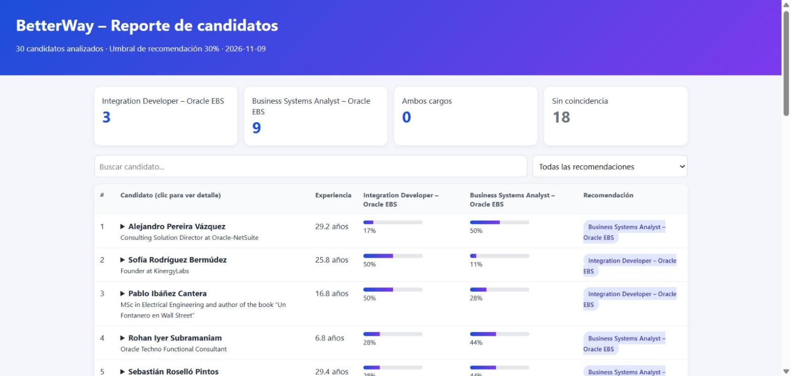

# BetterWay – Agente de coincidencia de candidatos

Herramienta en **Python** que lee perfiles de candidatos en PDF, los compara con los requisitos de las vacantes y genera un ranking con recomendaciones para el equipo de reclutamiento.



> Este proyecto nació como prueba técnica para BetterWay. La versión entregada está marcada con la etiqueta [`v1.0-entrega`](https://github.com/evelyn-escobar/betterway-candidate-matching-agent/tree/v1.0-entrega). La versión actual la mejoré después, con puntajes ponderados, configuración externa, reportes visuales y pruebas.

---

## ¿Qué hace?

1. Lee los PDF de candidatos (`input/candidates/`).
2. Extrae nombre, titular, ubicación y años aproximados de experiencia de cada perfil.
3. Compara el perfil con las habilidades de cada vacante definidas en `config.json`.
4. Calcula un **puntaje ponderado de 0 a 100** por vacante: las habilidades clave pesan más.
5. Recomienda al candidato para la vacante A, la B, ambas o ninguna, según un umbral configurable.
6. Genera tres reportes en `output/`:
   - `report.html`: reporte visual con barras de puntaje, búsqueda, filtro y detalle por candidato.
   - `report.md`: resumen, ranking y habilidades encontradas y faltantes de cada candidato.
   - `report.csv`: tabla para abrir en Excel o Google Sheets.

## Resultados con los 30 perfiles de la prueba

| Recomendación | Candidatos |
|---|---|
| Integration Developer – Oracle EBS | 3 |
| Business Systems Analyst – Oracle EBS | 9 |
| Ambos cargos | 0 |
| Sin coincidencia suficiente | 18 |

## Mejoras frente a la primera versión

- **Coincidencias precisas:** se buscan palabras y frases completas, sin distinguir mayúsculas ni tildes. Antes, "sap" coincidía dentro de otras palabras y "oracle" se contaba dos veces.
- **Sinónimos:** cada habilidad acepta varias formas de escribirse (por ejemplo, "Oracle EBS", "E-Business Suite" o "EBS R12").
- **Puntaje ponderado** en lugar de sumar 10 puntos por palabra.
- **Recomendación con umbral:** un candidato con un puntaje bajo en ambas vacantes ya no se recomienda para la "menos mala".
- **Configuración sin tocar el código:** vacantes, habilidades, pesos y umbral viven en `config.json`.
- **Reportes explicables:** cada candidato muestra qué habilidades tiene y cuáles le faltan.
- **Línea de comandos** con rutas configurables y **pruebas automáticas**.

## Instalación y uso

```bash
git clone https://github.com/evelyn-escobar/betterway-candidate-matching-agent.git
cd betterway-candidate-matching-agent

python -m venv .venv
.venv\Scripts\activate        # Windows
# source .venv/bin/activate   # macOS / Linux

pip install -r requirements.txt
python main.py
```

Opciones:

```bash
python main.py --candidates otra/carpeta --config config.json --output resultados
```

Luego abre `output/report.html` en el navegador.

## Configurar nuevas vacantes

Edita `config.json`. Cada vacante tiene un título y una lista de habilidades con peso y sinónimos:

```json
{"name": "PL/SQL", "weight": 2, "aliases": ["pl/sql", "plsql"]}
```

`fit_threshold` define el puntaje mínimo (0-100) para recomendar a un candidato.

## Pruebas

```bash
python -m unittest
```

## Estructura

```plaintext
betterway-candidate-matching-agent/
├── main.py              # Punto de entrada y línea de comandos
├── config.json          # Vacantes, habilidades, pesos y umbral
├── pdf_reader.py        # Lectura de texto de los PDF (pypdf)
├── profile_parser.py    # Nombre, titular, ubicación y años de experiencia
├── matcher.py           # Coincidencia de habilidades, puntaje y clasificación
├── report_generator.py  # Reportes HTML, Markdown y CSV
├── test_matcher.py      # Pruebas automáticas
├── input/
│   ├── candidates/      # 30 perfiles de prueba
│   └── jobs/            # 2 descripciones de vacantes
└── output/              # Reportes generados
```

## Próximos pasos posibles

- Análisis semántico con un modelo de lenguaje para entender experiencia descrita con otras palabras.
- Extraer automáticamente las habilidades desde los PDF de las vacantes.

## Autora

**Evelyn Daniela Escobar** – Estudiante de Tecnología en Desarrollo de Software (UNAD).
